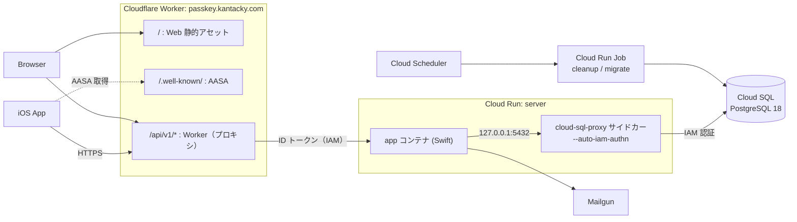
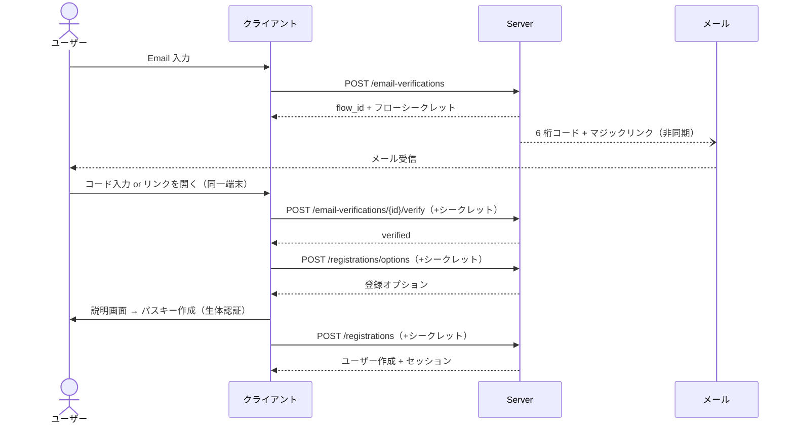
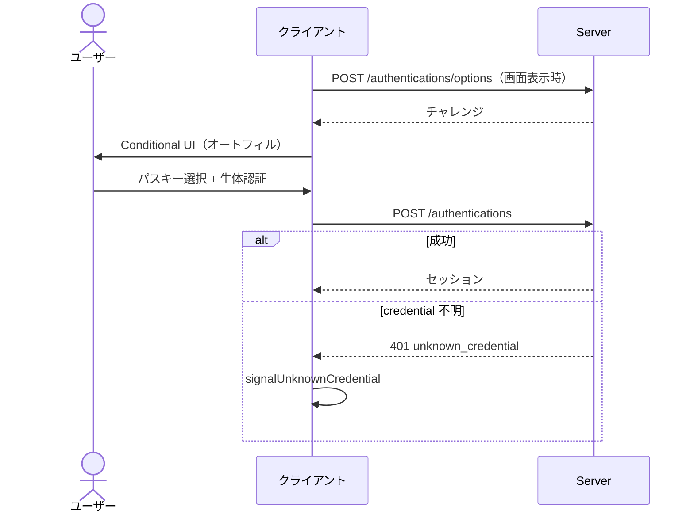
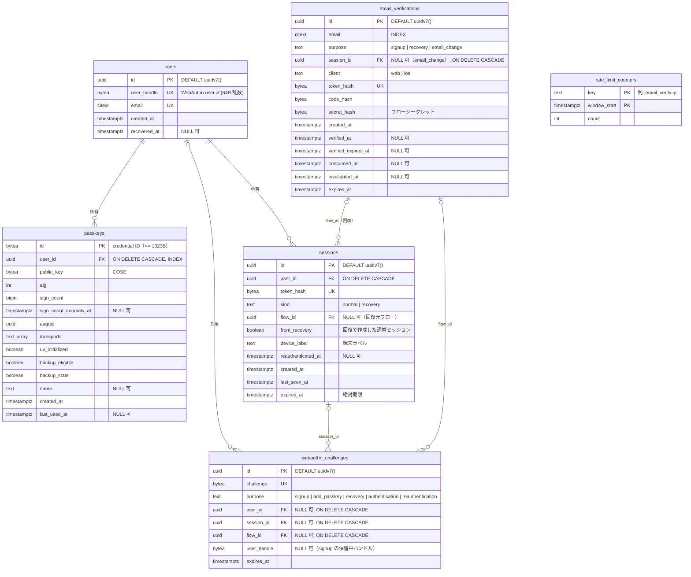

# Passkey 認証システム 設計書

## 0. 前提

- 準拠する指針: W3C WebAuthn Level 3、FIDO Alliance「Passkey Central / UX Design Guidelines」、passkeys.dev、Apple「Supporting passkeys」。以降まとめて「ガイドライン」と呼ぶ。
- 目標保証レベル: NIST SP 800-63B-4 の AAL2。パスキー（ユーザー検証必須）を多要素の暗号認証器として扱い、セッション管理は OWASP ASVS 5.0 L2 に合わせる。
- 本書で「必須」はガイドライン準拠のための要件、「推奨」は実装上の選択を指す。仕様の MUST ではなく本書独自の運用方針である項目は「方針」と明記する。

### 0.1 保証範囲

- AAL2 を満たすのは **パスキーによるサインインと再認証** である。
- サインアップとアカウント回復は Email 所有確認（out-of-band）に基づき、AAL2 の認証ではない。回復は登録時と同水準の本人確認として扱う（ASVS 6.4.4）。回復による乗っ取りの影響は §4.4 の通知と機密操作の制限で緩和する。

### 0.2 ガイドラインからの意図的な逸脱

| 項目 | ガイドライン | 本設計 | 理由 |
| --- | --- | --- | --- |
| パスキーなしのアカウント | FIDO principle 4（パスキー以外の手段も選べる） | パスキー必須。パスワード等は持たない | パスキーを唯一の認証手段とし、AAL2 とフィッシング耐性を常に保つため |
| 最後のパスキー削除 | FIDO 削除パターン（警告付きで許可） | 禁止（`409 last_passkey`） | 0 件になると Email 回復だけに依存する状態になるため。全削除はユーザー削除で行う |
| `userVerification` | passkeys.dev の既定は `preferred` | `required` | AAL2 の多要素要件のため |
| 回復後のパスキー選択 | FIDO principle 4（回復時に手段を選べる） | 回復後のパスキー作成は必須 | パスキー以外の手段がないため |

## 1. 全体構成



- RP ID: `passkey.kantacky.com`（Web と iOS で共通）。実装では環境変数 `RP_ID` から読む（ローカル開発で `localhost` に切り替えるため）。
- 許可 Origin: `https://<RP ID>`。iOS は Apple プラットフォームが同 Origin を送る。`apple-app-site-association` で関連付ける。
- API を同一 Origin（`/api/v1`）で提供し、Cookie を `SameSite=Strict` にでき、CORS を不要にする。
- メール送信: Mailgun。送信ドメインはサブドメイン `mail.<RP ID>`（親ドメインの評判と分離）、送信元 `no-reply@mail.<RP ID>`。SPF / DKIM / DMARC を設定する（DMARC は `p=none` で開始し、レポート確認後に `quarantine` → `reject`）。トラッキング（開封・クリック）は無効化し、リンクを書き換えさせない。
- 対応プラットフォーム: iOS と Web のみ。Android アプリは対応しない（`assetlinks.json` は配信しない。Android 端末のブラウザからの Web 利用は可）。

環境は本番のみ（ステージング環境は作らない）。動作確認はローカル（§9.1、§10 の開発サーバー）で行う。ローカルの RP ID は `localhost`。

### 1.1 開発ツール

| ツール | 管理方法 |
| --- | --- |
| Bun、Node、Terraform、その他の CLI | mise。リポジトリ直下の `mise.toml` でバージョンを固定する（`bun`、`node` = 26 系、`terraform` = 1.17.2、必要に応じて `gcloud` 等） |
| Swift（server） | swiftly（ローカルにインストール済み）。`server/.swift-version` に `6.4.3` を書き、swiftly がディレクトリごとに切り替える。コンテナは同じ版の `swift:6.4.3-noble` |
| Swift（iOS） | Xcode 同梱のツールチェーン |

CI を導入する場合も mise（`jdx/mise-action`）と swiftly で揃える。`package.json` の `packageManager` は使わない（バージョンの指定元を mise に一本化する）。

## 2. ユーザー体験（機能一覧）

| 機能 | 概要 |
| --- | --- |
| サインアップ | Email 入力 → 6 桁コード（またはマジックリンク）で所有確認 → パスキー作成 → サインイン完了 |
| サインイン | パスキー（オートフィル / Conditional UI を第一、ボタンからのモーダルも提供） |
| アカウント回復 | Email 入力 → 所有確認 → 新しいパスキー作成を必須とした上でサインイン |
| パスキー追加 | 再認証 → パスキー作成 |
| パスキー一覧 | カード表示: 名前、提供元アイコン、作成日時、最終使用日時、同期可否 |
| パスキー名変更 | 任意（1〜64 文字）。未設定時の表示名は §7.2 |
| パスキー削除 | 再認証 → 確認 → 削除 → Signal API 通知。最後の 1 件は削除不可（§0.2） |
| サインアウト | 現在のセッションを失効 |
| セッション管理 | サインイン中のセッション（端末・最終アクセス）一覧、個別失効、他のセッションをすべてサインアウト（いずれも再認証が必要） |
| Email 変更 | 再認証 → 新しい Email の所有確認 → 変更 → 新旧の Email に通知 → Signal API で表示名を更新 |
| ユーザー削除 | 再認証 → 確認（Email 再入力）→ 全データ削除 → Signal API 通知 |

### 2.1 UX 方針（ガイドライン準拠）

- 用語は「パスキー」で統一（「FIDO」「WebAuthn」「認証器」等を UI に出さない）。「顔・指紋」をパスキーの同義語として使わない（パスキーを使う手段として説明する）。
- サインイン画面の Email 欄に `autocomplete="username webauthn"` を付け、ページ表示時に Conditional UI を開始する。
- 「パスキーでサインイン」ボタンも併設（Conditional UI 非対応環境用）。
- 文言は利用者を責めない表現にし、各画面を「タイトル・説明・次の操作（ボタン）・ヘルプへのリンク」で構成する。

### 2.2 パスキー作成の前後

- 作成前に説明画面を挟む（OS のダイアログが出る前）。
  - 見出し: 「パスキーを作成」
  - 説明: 「パスキーは、顔・指紋・画面ロックを使ってサインインするためのデジタルの鍵です。iCloud キーチェーンや Google パスワードマネージャーなどのパスワード管理に保存され、同じアカウントの他の端末でも使えます。」
  - ボタン: 「パスキーを作成」
- Web では作成前に `PublicKeyCredential.isUserVerifyingPlatformAuthenticatorAvailable()` を確認する。false の場合も作成は可能（スマートフォンの QR・セキュリティキー）だが、その旨を説明に添える。
- 作成後:
  - 「パスキーを作成しました」と、保存先（提供元名が分かれば表示）と「次回からこのパスキーでサインインできます」を表示する。
  - 同期されないパスキー（BE=0）の場合は「このパスキーはこの端末（またはセキュリティキー）でのみ使えます」と添える。

### 2.3 エラー時の文言

| 状況 | タイトル | 説明・操作 |
| --- | --- | --- |
| 作成キャンセル（`NotAllowedError`） | パスキーの作成を中止しました | エラー扱いにしない。「パスキーを作成」ボタンで再試行 |
| 作成失敗 | パスキーを作成できませんでした | 「もう一度お試しください」+ 再試行ボタン。サインアップではパスキーが唯一の手段であることを説明 |
| 登録済み（`InvalidStateError`） | このパスキーは登録済みです | 「このパスキーでサインインできます」+ サインインへ |
| UV 不可 | 画面ロックが必要です | 「端末の画面ロック（パスコード等）を設定してから、もう一度お試しください」 |
| 該当パスキーなし（`unknown_credential`） | このパスキーは使えません | 「削除されたパスキーです。別のパスキーを選ぶか、アカウントを回復してください」 |
| 時間切れ | 時間切れです | 「もう一度お試しください」+ 再試行（チャレンジ再取得、§4.3） |

### 2.4 アカウント設定画面

- 「パスキー」「セッション」「アカウント削除」を同じ見出しレベルのセクションとし、「パスキー」を最上部に置く。
- パスキーは 1 件 1 枚のカード（アイコン、名前、作成日時、最終使用日時、同期可否、名前変更・削除の操作）で表示する。
- セクション冒頭に、パスキーとは何か・どこに保存されるかの説明を常時表示する。
- 最後の 1 件の削除ボタンは無効化し、理由「別のパスキーを追加してから削除してください」をボタンの隣に表示する（ツールチップにしない）。
- アイコンが解決できない場合は汎用のパスキーアイコンを表示する。

### 2.5 アクセシビリティ

- WCAG 2.2 AA を目標とする。
- コード入力欄: `inputmode="numeric"`、`autocomplete="one-time-code"`、貼り付け可能。iOS は `.textContentType(.oneTimeCode)`。
- エラーと状態変化は `aria-live` で通知し、エラー時は該当欄にフォーカスを移す。
- 色だけで状態を表さない。
- 時間制限（コード 10 分、回復セッション 15 分）は残り時間を表示し、期限切れ時は「コードを再送」「最初からやり直す」の操作を置く（WCAG 2.2.1）。

## 3. WebAuthn パラメータ

### 3.1 登録（`navigator.credentials.create` / `ASAuthorizationPlatformPublicKeyCredentialProvider`）

| 項目 | 値 |
| --- | --- |
| `rp.id` | `RP_ID`（本番 `passkey.kantacky.com`） |
| `rp.name` | `Passkey` |
| `user.id` | 64 バイト乱数（ユーザーごと固定、base64url）。内部 ID（UUID v7）とは別物 |
| `user.name` | Email（Email をユーザー名として扱う） |
| `user.displayName` | Email（表示名機能は持たない） |
| `challenge` | 32 バイト乱数、サーバー保存、有効期限 5 分、使い捨て |
| `pubKeyCredParams` | `-7`(ES256), `-257`(RS256)。Ed25519（`-8`）は `webauthn-swift` が未対応のため載せない（§11） |
| `authenticatorSelection.residentKey` | `required` |
| `authenticatorSelection.userVerification` | `required`（AAL2 のため。UV できない認証器を登録させない） |
| `authenticatorSelection.authenticatorAttachment` | 指定しない |
| `hints` | 指定しない |
| `attestation` | `none` |
| `excludeCredentials` | ユーザーの既存パスキー全件 |
| `timeout` | 240000 ms（Web のみ。チャレンジの有効期限より短くし、期限の境界で失敗しないようにする） |

`user.id` に Email を入れない理由: ユーザーハンドルは認証器に保存され、個人情報を含めてはならない（WebAuthn L3）。また Email は識別子として不変である保証がない。内部 ID との関係は §7.3 を参照。

### 3.1.1 Web と iOS の相互利用

Web と iOS は同じ RP ID を使い、iOS アプリは Associated Domains（`webcredentials`）で関連付けるため、どちらで登録したパスキーももう一方で使える。どのパスワード管理（iCloud キーチェーン、1Password 等）に保存されるかは OS とパスワード管理の責務で、本サービスは区別しない。

iOS は登録・認証とも、`ASAuthorizationPlatformPublicKeyCredentialProvider` と `ASAuthorizationSecurityKeyPublicKeyCredentialProvider` の 2 つのリクエストを 1 つの `ASAuthorizationController` に渡す。

- セキュリティキー用リクエストにも `userVerificationPreference = .required`、`excludedCredentials`（登録時）、`allowedCredentials`（再認証時）、`credentialParameters`（ES256 / RS256）、`residentKeyPreference = .required` を設定する。UV 必須のため PIN を設定したキーが必要。
- Conditional UI（`performAutoFillAssistedRequests()`）はプラットフォーム用リクエストのみ（セキュリティキーはボタンからのモーダルで使う）。
- 受け入れ条件として、Web で登録 → iOS アプリでサインイン、およびその逆を実機で確認する（セキュリティキーを含む）。

### 3.2 認証（`navigator.credentials.get`）

| 項目 | 値 |
| --- | --- |
| `rpId` | `RP_ID` |
| `challenge` | 32 バイト乱数、有効期限 5 分、使い捨て |
| `allowCredentials` | サインイン時は空（Discoverable Credential 前提。ユーザー列挙を防ぐ）。再認証時は自分のパスキー全件 |
| `userVerification` | `required` |
| `mediation` | Conditional UI 時 `conditional` |
| `timeout` | 240000 ms（Web のモーダルのみ） |

### 3.3 サーバー検証（必須）

チャレンジ:

- 最初に `DELETE FROM webauthn_challenges WHERE challenge = $1 AND expires_at > now() RETURNING *` で原子的に消費する。取得できなければ `400 invalid_challenge`。検証が失敗してもチャレンジは消費済みとする。
- チャレンジの束縛先（フロー / セッション / なし）と purpose が、リクエストの認証コンテキストと一致すること（§7.1 `webauthn_challenges`）。

登録・認証共通:

- `clientDataJSON.type`、`challenge`、`origin`（`https://passkey.kantacky.com` と完全一致。iOS アプリからも同じ Origin が送られる）を検証。`crossOrigin` が true なら拒否（方針: iframe での利用を想定しないため）。
- `rpIdHash` が `SHA-256(RP_ID)` と一致。
- フラグ: UP と UV を必須。BE=0 かつ BS=1 は拒否。

登録時の追加検証:

- `attestationObject.fmt` が `none` であること。
- 公開鍵の `alg` が、発行した `pubKeyCredParams` に含まれること（WebAuthn L3 §7.1 step 20）。
- credential ID が 1023 バイト以下で、どのユーザーにも登録済みでないこと（同 step 26）。衝突時は上書きせず `409 credential_exists`。
- `uv_initialized` = UV フラグ、`backup_eligible` = BE、`backup_state` = BS を保存する。

認証時の追加検証:

- `userHandle` が存在すること（Discoverable Credential のため必須）。
- `userHandle` から引いたユーザーと credential の所有者が一致すること（WebAuthn L3 §7.2 step 6）。
- 再認証では、credential の所有者がセッションのユーザーと一致すること。
- BE が登録時の保存値と異なれば拒否（BE は変化しない）。
- 署名を保存済み公開鍵で検証する。
- `signCount`（方針）: 両方 0 なら無視。保存値以下に減少したら `passkeys.sign_count_anomaly_at` に記録し警告ログを出す。同期パスキーは 0 のままのことが多く、減少は複製を断定できないため、ロックはしない。
- 成功時は `sign_count`（`UPDATE ... WHERE sign_count < $new` で単調増加）、`backup_state`、`uv_initialized`（UV=1 なら true）、`last_used_at` を更新する。

`aaguid` は `attestation: none` のためクライアントが偽装でき、検証できない。表示名・アイコンの決定にだけ使い、許可・拒否の判断には使わない。

#### ライブラリとアプリの分担

`webauthn-swift`（1.0.0-beta.4）が行う検証と、アプリで実装する検証を分ける。

| 検証 | 担当 |
| --- | --- |
| `type`・`challenge`・`origin`（単一 Origin の完全一致）、`rpIdHash`、UP、UV（`requireUserVerification: true`）、署名 | ライブラリ |
| `alg` の許可（`supportedPublicKeyAlgorithms`）、credential ID の未登録確認（`confirmCredentialIDNotRegisteredYet` コールバック） | ライブラリ（アプリがパラメータ・コールバックを渡す） |
| チャレンジの原子的な消費と束縛、`crossOrigin`、`fmt` が `none`、credential ID の長さ、BE=0 かつ BS=1 の拒否、BE の変化、`userHandle` の存在と所有者一致、`uv_initialized` | アプリ |
| signCount | アプリ。ライブラリは減少時に署名検証の前で `potentialReplayAttack` を投げ、本書の方針（記録のみでロックしない）と合わないため、`credentialCurrentSignCount` には常に 0 を渡し、比較は検証成功後にアプリで行う |

ライブラリは 1.0 未満のため、バージョンを固定し、更新時は上記の分担が変わっていないか確認する。

## 4. フロー

Email による所有確認は **サインアップ** と **アカウント回復** にだけ使い、通常のサインインはパスキーのみとする。メールはフィッシング耐性がなく、サインイン手段にするとパスキー導入の効果が失われる。

シーケンス図中の API パスは `/api/v1` を省略して記す。

### 4.1 サインアップ

1. クライアント → `POST /api/v1/email-verifications {email, purpose: "signup"}`。
   - クライアント種別（`web` / `ios`）はサーバーが §5.2 の規則で判定し、フローに保存する。
   - サーバーはフロー ID と **フローシークレット**（32 バイト乱数）を発行する。Web はフローシークレットを `__Host-flow` Cookie（§6.1）で返し、フロー ID をボディで返す。iOS は両方をボディで返し、Keychain に一時保存する。
   - 同一 Email・同一 purpose の未消費の旧フローは無効化する。
   - ユーザー列挙防止のため、既存 Email でも同じ応答（`202`）を返す。既存なら「既にアカウントがあります。サインインまたはアカウント回復をしてください」というメールを送る。
   - メール送信は応答後に非同期で行い（§9.3）、全分岐で応答時間を揃える。
2. メールの件名・冒頭に 6 桁コードを大きく記載し、続けてマジックリンクを記載する。
   - Web 起点: `https://<RP ID>/verify?flow=<flow_id>#token=<token>`
   - iOS 起点: `https://<RP ID>/app/verify?flow=<flow_id>#token=<token>`（Universal Link の対象はこのパスのみ。§8）
   - token はフラグメントに置き、サーバーのアクセスログに残さない。
   - トークン 32 バイト乱数、トークン・コードとも有効期限 10 分（NIST SP 800-63B-4 §3.1.3.2）、1 回限り、DB にはハッシュのみ保存。
3. 元の画面はコード入力欄を表示して待機する。検証 `POST /api/v1/email-verifications/{id}/verify {token | code}` はフローシークレットを要求する。
   - 同一端末（同一ブラウザ / アプリ）で開いた場合のみ成功する。フローシークレットが欠落・不一致の場合は `403 device_mismatch` を返し、**トークンを消費しない**（メールスキャナーや別端末で開いた場合に正規のリンクを無効にしないため）。
   - `device_mismatch` の画面は「メールに記載の 6 桁コードを、登録を始めた画面で入力してください」と案内し、コードの場所を示す。
   - コードの失敗回数は Email 単位で 1 時間累積し、5 回失敗でその Email の全フローを無効化する（新しいフローを作ってもリセットされない）。
   - 元の画面は `GET /api/v1/email-verifications/{id}`（フローシークレット必須）を数秒間隔でポーリングし、同一端末の別タブでリンクから検証された場合も自動で次へ進む。
4. 検証成功でフローは `verified` になり、以後 15 分間（`verified_expires_at`）登録に使える。
5. 登録オプション発行 `POST /api/v1/registrations/options`（フローシークレット必須）。サーバーはこの時点で `user_handle` を生成し、チャレンジ行に保存する。
6. パスキー作成（§2.2）→ `POST /api/v1/registrations`（フローシークレット必須）。チャレンジ行の `user_handle` を使い、ユーザー・パスキーを同一トランザクションで作成し、フローを消費（`consumed_at`）してセッションを発行する。
   - 同じ Email が別フローで先に登録済みの場合（`users.email` の一意制約違反）は `409 email_taken` を返し、サインイン・回復へ案内する。
7. パスキー作成をキャンセル・失敗した場合はユーザーを作成しない（`verified_expires_at` まで同フロー内で再試行可）。

フローの状態: `pending` →（検証）→ `verified` →（登録 / 回復セッション発行）→ `consumed`。`pending` は `expires_at`、`verified` は `verified_expires_at` を過ぎると `expired`。



### 4.2 マジックリンクを端末に束縛する理由

リンク単体を Bearer として扱うと、メール転送・プレビュー（リンクスキャナー）・フィッシングで第三者がセッションを得られる。フローシークレットとの照合で「メールを受信した人」かつ「フローを開始した端末」の両方を要求する（ASVS 6.6.2）。リンクの GET では状態を変更せず、ページ側から POST で検証する（メールスキャナー対策）。

メールアプリ内のブラウザで開かれた場合や、別端末で開かれた場合は Cookie / Keychain を共有できず検証できないため、コード入力を主な導線とする。

### 4.3 サインイン

1. `POST /api/v1/authentications/options` → チャレンジ取得（Conditional UI 用にページ表示時に取得）。
2. パスキーで署名 → `POST /api/v1/authentications`。
3. 成功で新しいセッションを発行（既存のセッション Cookie があれば失効させる）。`reauthenticated_at = now()` とする。
4. 該当 credential が存在しない場合は `401 unknown_credential` を返す。Web は `PublicKeyCredential.signalUnknownCredential`、iOS 26.2 以降は `ASCredentialDataManager` の `reportUnknownPublicKeyCredential`（§8）を呼ぶ。

Conditional UI の制御:

- チャレンジの有効期限が切れる前（4 分経過時）に Conditional UI を abort し、新しいチャレンジで再開する。
- モーダル認証を始める前に Conditional UI を abort する。モーダルが終了（成功以外）したら、新しいチャレンジで Conditional UI を再開する。
- iOS は同時に 1 つの `ASAuthorizationController` だけを実行する。画面表示時に `performAutoFillAssistedRequests()` を開始し、モーダル開始時・画面離脱時にキャンセルする。



### 4.4 アカウント回復

1. `POST /api/v1/email-verifications {purpose: "recovery"}`。未登録 Email でも同じ応答。
   - 登録済みなら回復コード・リンクのメールを送る。未登録なら「このメールアドレスのアカウントはありません。新規登録はこちら」というメールを送る。
2. 検証は §4.1 と同様。
3. 検証成功で、フローを消費し、同一トランザクションで **回復セッション**（§6.1、絶対 15 分）を発行する。この時点で「アカウント回復が開始されました。心当たりがない場合は…」という通知メールを送る。
4. 回復セッションで呼べる API は次のみ。それ以外は `403 recovery_session_restricted`。
   - `GET /me`、`POST /registrations/options`、`POST /registrations`、`DELETE /sessions/current`
5. 新しいパスキーを作成した時点で、回復セッションを失効させ、新しいトークンの通常セッションを発行する（セッション固定化対策）。あわせて次を行う。
   - 他の全セッションを失効させる。
   - `users.recovered_at = now()` を記録する。
   - 「アカウント回復が完了しました」通知メールを送る（本人でない場合の対処を記載）。
6. 回復完了画面で既存のパスキー一覧を表示し、「紛失した端末のパスキーは削除してください」と案内する。
7. 回復から 24 時間は、パスキー削除・Email 変更・ユーザー削除を `403 recently_recovered` で拒否する（方針）。この間、パスキー一覧に「以前のパスキーは <日時> 以降に削除できます」と表示する。
   - 理由: メールアカウントを奪った攻撃者が回復した場合に、正規ユーザーのパスキーを消して締め出したり、アカウントを削除したりするのを防ぐ。正規ユーザーは通知メールと既存パスキーでサインインし、攻撃者のパスキーとセッションを失効させられる（24 時間の制限は回復したセッションにのみ適用し、既存パスキーでサインインしたセッションには適用しない）。

### 4.5 パスキー追加

再認証（§6.3）→ 登録オプション（`excludeCredentials` 付き）→ 作成（§2.2）→ 保存。追加時に通知メールを送る。完了画面で「他のセッションをすべてサインアウト」を提示する（ASVS 7.4.3）。

### 4.6 パスキー削除

1. 再認証 → 確認ダイアログ（対象のカードを強調表示したまま表示）。
   - 見出し: 「このパスキーを削除しますか？」
   - 説明: 「削除すると、このパスキーではサインインできなくなります。」
   - ボタン: 「キャンセル」「パスキーを削除」
2. 最後の 1 件は削除できない（§0.2）。UI では §2.4 のとおり無効化する。サーバーも `409 last_passkey` で拒否する（同時削除に備え、件数確認と削除は同一トランザクションで行い、ユーザー行を `SELECT ... FOR UPDATE` でロック）。
3. `DELETE /api/v1/passkeys/{id}`（id は credential ID の base64url）。応答には削除後の全 credential ID を含める。通知メールを送る。
4. クライアントは応答の最新 ID 一覧で `PublicKeyCredential.signalAllAcceptedCredentials({rpId, userId, allAcceptedCredentialIds})` を呼び、認証器側から削除させる（キャッシュした一覧は使わない）。iOS 26.2 以降は `ASCredentialDataManager` の `reportAllAcceptedPublicKeyCredentials` を使う。
5. 完了画面:
   - 全環境で「パスキーを削除しました。このパスキーは今後どの端末でも使えません」と表示する。
   - 任意の手順として「端末のパスワード管理からもこのパスキーを削除できます」を折りたたみで常に示す（Signal API が使えても、反映されない提供元があるため）。
   - 「他のセッションをすべてサインアウト」を提示する。

理由: パスキーが 0 件になると、Email 回復だけに依存する状態になる。全パスキーを消したい場合はユーザー削除（§4.8）を使う。また、サーバーで削除しただけでは端末側に使えないパスキーが残り続けるため、Signal API で通知する。

### 4.7 Email 変更

1. 再認証（§6.3）→ 新しい Email を入力。
2. `POST /api/v1/email-verifications {email: <新 Email>, purpose: "email_change"}`（セッション(再認証済)必須）。フローはセッションに束縛する（`email_verifications.session_id`）。
   - 新 Email が他のユーザーに使われている場合も同じ応答を返し（列挙防止）、新 Email には「このメールアドレスは既に使われています」というメールを送る。
3. 新 Email に届いたコード / リンクで §4.1 と同様に検証する。検証にはフローシークレットに加え、同じユーザーのセッションを要求する。
4. 検証成功で `users.email` を更新し、フローを消費する。競合時は `409 email_taken`。トークンを再発行し（§6.1）、他の全セッションを失効させる。
5. 通知: 旧 Email に「メールアドレスが変更されました（新しいアドレスの一部を伏せて表示）。心当たりがない場合は…」、新 Email に完了通知を送る。
6. クライアントは認証器側のユーザー名を更新する。Web は `PublicKeyCredential.signalCurrentUserDetails({rpId, userId, name, displayName})`、iOS 26.2 以降は `ASCredentialDataManager` の `reportPublicKeyCredentialUpdate`（§8）。未対応環境では「パスワード管理に表示されるメールアドレスは古いままの場合があります。サインインには影響しません」と表示する。

`user.id`（ユーザーハンドル）は変わらないため、既存のパスキーはそのまま使える。

### 4.8 ユーザー削除

1. 再認証 → Email の再入力で確認（誤操作防止）。
2. クライアントは削除前に `GET /me` の `userHandle` を保持する。
3. `DELETE /api/v1/me {email}`。ユーザー・パスキー・セッション・チャレンジを物理削除し、同じ Email の検証レコードも削除する。セッション Cookie を削除する `Set-Cookie` を返す。完了メールを送る。
4. クライアントは保持した `userHandle` で `signalAllAcceptedCredentials` に空配列を渡す（iOS も同様。§8 の注意を参照）。

## 5. API

ベースパス `/api/v1`（表のパスはこれからの相対）。`/.well-known/apple-app-site-association` は API ではなく Worker が配信する（§10）。JSON、エラーは `{"error": {"code": "...", "message": "..."}}`。

| メソッド | パス | 認証 | 説明 |
| --- | --- | --- | --- |
| POST | `/email-verifications` | なし / セッション(再認証済) | 検証フロー開始（signup / recovery / email_change。email_change はセッション必須） |
| GET | `/email-verifications/{id}` | フローシークレット | フローの状態（`pending` / `verified` / `consumed` / `expired`） |
| POST | `/email-verifications/{id}/verify` | フローシークレット（email_change はセッションも） | トークン or コード検証。recovery では回復セッションを発行、email_change では Email を更新 |
| POST | `/registrations/options` | 検証済みフロー（+シークレット） / セッション(再認証済) / 回復セッション | 登録オプション |
| POST | `/registrations` | 同上 | パスキー登録（signup 時はユーザー作成） |
| POST | `/authentications/options` | なし / セッション | 認証オプション（`reauth: true` で自分のパスキーに限定し、チャレンジをセッションに束縛） |
| POST | `/authentications` | なし / セッション | サインイン / 再認証 |
| GET | `/sessions` | セッション | セッション一覧（端末ラベル・作成日時・最終アクセス・現在のセッションか） |
| DELETE | `/sessions/current` | セッション / 回復セッション | サインアウト |
| DELETE | `/sessions/{id}` | セッション(再認証済) | 指定セッションを失効（自分のセッションのみ） |
| POST | `/sessions/revoke-others` | セッション(再認証済) | 現在以外の全セッションを失効 |
| GET | `/me` | セッション / 回復セッション | ユーザー情報（`userHandle`、セッション種別 `kind`、`recoveredAt`） |
| DELETE | `/me` | セッション(再認証済) | ユーザー削除（ボディ `{email}`） |
| GET | `/passkeys` | セッション | 一覧 |
| PATCH | `/passkeys/{id}` | セッション | 名前変更（ボディ `{name: string \| null}`、1〜64 文字、`null` で既定に戻す）。名前は認証手段の変更ではないため再認証不要 |
| DELETE | `/passkeys/{id}` | セッション(再認証済) | 削除（最後の 1 件は `409 last_passkey`）。応答に残りの credential ID 全件 |

「再認証済」は §6.3 の鮮度を満たすこと。登録（パスキー追加）の鮮度は `/registrations/options` の発行時に検査し、`/registrations` ではチャレンジの束縛で担保する。

### 5.1 エラーコード

| HTTP | `code` | クライアントの動作 |
| --- | --- | --- |
| 400 | `invalid_request` | 入力エラーを表示 |
| 400 | `invalid_challenge` | チャレンジを再取得して再試行 |
| 400 | `invalid_code` | 「コードが正しくありません」（残り回数は表示しない） |
| 400 | `verification_failed` | WebAuthn 検証失敗。§2.3 の作成失敗 / 認証失敗を表示 |
| 401 | `unauthenticated` | セッション期限切れ。サインイン画面へ |
| 401 | `unknown_credential` | Signal API で通知し、§2.3 を表示 |
| 403 | `origin_mismatch` | （通常は発生しない） |
| 403 | `device_mismatch` | 「登録を始めた画面でコードを入力してください」 |
| 403 | `reauthentication_required` | 再認証して再実行 |
| 403 | `recovery_session_restricted` | パスキー作成画面へ |
| 403 | `recently_recovered` | 操作可能になる日時を表示 |
| 404 | `not_found` | — |
| 409 | `last_passkey` | §2.4 の文言 |
| 409 | `credential_exists` | §2.3「登録済み」 |
| 409 | `email_taken` | サインイン・回復へ案内 |
| 410 | `flow_expired` | 「時間切れです」+ 最初からやり直す |
| 429 | `rate_limited` | `Retry-After` 秒後に再試行可能と表示 |

### 5.2 クライアント種別と資格情報

- リクエストに `Origin` ヘッダーがあればブラウザ（`web`）とみなす。`web` には Cookie でのみ秘密を返し、ボディに含めない。
- `ios` として扱うのは `Origin` ヘッダーがなく、`X-Client: ios` が付いたリクエストのみ。ブラウザは POST で必ず `Origin` を付けるため、XSS から `ios` として振る舞いトークンを JS で読むことはできない。
- 1 リクエストで Cookie と `Authorization` の両方のセッションが送られた場合は `400 invalid_request` で拒否する。
- CSRF 用の `Origin` 検証の要否は、実際に使った資格情報（Cookie か Bearer か）で決める。

### 5.3 レート制限

| 対象 | キー | 上限 | 場所 |
| --- | --- | --- | --- |
| 全 API | IP | 60 回/分 | Cloudflare Workers Rate Limiting binding（`period` は 10 / 60 秒のみ。カウントはロケーション単位の近似値のため粗い防御に限る） |
| `POST /email-verifications` | IP | 20 回/時 | DB |
| `POST /email-verifications` | Email | 5 回/時、かつ前回送信から 60 秒 | DB |
| コード検証の失敗 | Email | 5 回/時（§4.1） | DB |
| `POST /authentications` の失敗 | IP | 30 回/時 | DB |

- IP は §9.2 の `X-Client-IP` を使う。IPv6 は /64 単位で集計する。
- Email 単位の上限を超えても応答は `202` のまま（メール送信だけを抑止する）。攻撃者が上限を使い切っても、正規ユーザーは 1 時間後に再試行できる。応答が変わらないため列挙にも使えない。
- DB カウンタは §7.1 `rate_limit_counters`。

## 6. セッション・セキュリティ

### 6.1 セッション

- 256 bit 乱数のトークン、DB には SHA-256 ハッシュを保存。
- Web: Cookie `__Host-session`、`HttpOnly; Secure; SameSite=Strict; Path=/`。
- iOS: `Authorization: Bearer`、Keychain（`kSecAttrAccessibleAfterFirstUnlockThisDeviceOnly`）に保存。
- 有効期限（NIST SP 800-63B-4 の AAL2 推奨値に合わせる）: 無操作 1 時間、絶対 24 時間。期限切れ後はパスキーで再サインイン（UV 付き）する。
- 回復セッションは絶対 15 分。
- トークンの再発行: サインイン、再認証、回復セッションから通常セッションへの切り替えのたびに新しいトークンを発行し、旧トークンを失効させる（ASVS 7.2.4）。
- 同時セッション数の上限はユーザーあたり 20。超過時は最終アクセスが最も古いセッションを失効させる（ASVS 7.1.2）。
- セッションには端末ラベル（iOS アプリは `Passkey-iOS/<版> (<機種>; iOS <版>)` 形式の User-Agent から、Web はブラウザ名・OS）を保存し、一覧表示に使う。
- `last_seen_at` は前回更新から 5 分以上経過した場合のみ更新する（書き込み負荷の抑制）。
- フローシークレット Cookie: `__Host-flow`、`HttpOnly; Secure; SameSite=Strict; Path=/; Max-Age=1500`（検証 10 分 + 登録 15 分）。フロー消費時に削除する。

### 6.2 CSRF

同一 Origin + `SameSite=Strict` に加え、Cookie で認証する状態変更リクエストは `Origin` ヘッダーを検証（不一致・欠落は拒否）。これは ASVS 3.5 が認める対策である。iOS の Bearer 認証リクエストは Cookie を使わず CSRF の対象外のため、Origin 検証を行わない（§5.2）。

### 6.3 再認証

- 機密操作（パスキー追加・削除、Email 変更、ユーザー削除、他セッションの失効）は、セッションの `reauthenticated_at` が 5 分以内であることを要求（ASVS 7.5.1、7.5.2）。
- サインイン直後・サインアップ直後・回復完了直後も `reauthenticated_at = now()` とする。
- 期限切れ・未再認証の場合、サーバーは `403 reauthentication_required` を返す。
- 再認証は UV 付きのパスキー認証で、自分の credential に限定（`allowCredentials` に自分のパスキー全件）。サーバーはチャレンジがそのセッションに束縛されていること、credential の所有者がセッションのユーザーであることを検証する（§3.3）。成功時はトークンを再発行する（§6.1）。
- 回復セッションはパスキー登録のみ可能で、再認証の代替とはしない。
- 理由: セッション乗っ取りや端末の置き忘れで第三者が操作した場合でも、認証手段の変更（パスキー追加・削除）や取り消せない操作（ユーザー削除）、正規ユーザーの締め出し（セッション失効）をさせないため。

### 6.4 通知

次の場合に Email 通知を送る。本文には操作の種類、日時、端末ラベル、おおよその地域（国）と、心当たりがない場合の対処を記載する。国はサーバーが受け取った `X-Client-Country`（§9.2、§10）を日本語表示にしたもので、取得できない場合は「不明」とする。

- パスキー追加・削除
- アカウント回復の開始・完了
- Email 変更（新旧両方）
- ユーザー削除

### 6.5 その他

- セキュリティヘッダー（Worker の応答と静的アセットの両方に付与。§10）:
  - `Strict-Transport-Security: max-age=63072000; includeSubDomains`
  - `Content-Security-Policy: default-src 'self'; frame-ancestors 'none'; base-uri 'none'; form-action 'self'; object-src 'none'`
  - `X-Content-Type-Options: nosniff`、`Referrer-Policy: no-referrer`
- `/verify`・`/app/verify` は読み込み直後に `history.replaceState` で URL から token を除去する。token はフラグメントのためサーバーには送られない。
- ログに Email・トークン・チャレンジを平文で出さない（Email はハッシュ化した ID で出力）。
- セキュリティイベントを構造化ログに出す（ASVS 16）: サインイン成功・失敗、再認証、検証コードの失敗、回復の開始・完了、パスキー追加・削除、セッション失効、レート制限超過、signCount 異常。

## 7. データモデル（PostgreSQL）



### 7.1 テーブルの補足

- `webauthn_challenges` の束縛: `signup` は `flow_id` と `user_handle`、`add_passkey` / `recovery` / `reauthentication` は `session_id` と `user_id` を必ず持つ。`authentication`（サインイン）はどれも持たない。
- `email_verifications` のコード失敗回数は §5.3 の `rate_limit_counters`（キー `code_fail:email:<hash>`）で Email 単位に数える。
- `sessions.from_recovery` は §4.4 の 24 時間制限の判定に使う（`users.recovered_at` から 24 時間以内、かつ `from_recovery` のセッション）。
- 主キーの UUID は `passkeys`（credential ID）と `rate_limit_counters` を除き UUID v7（`uuidv7()`、PostgreSQL 18 以降）。時系列順に並ぶため B-tree の挿入局所性が良い。
- `citext` 拡張はマイグレーションで `CREATE EXTENSION` する。

### 7.2 パスキーの表示名

- `name` が設定されていればそれを表示する。
- 未設定なら「<提供元名>（<作成日>）」。AAGUID が全ゼロ（Apple 等は `attestation: none` で匿名化する）または既知リストにない場合は「パスキー（<作成日>）」。
- 表示名は保存せず表示時に導出する。
- 既知 AAGUID の対応表とアイコン（ライト・ダーク）はコミュニティ管理の一覧（passkey-authenticator-aaguids）をサーバーに同梱して定期更新する。

### 7.3 ユーザー ID とユーザーハンドルを分ける理由

- Email はユーザー名（`users.email`）として一意に保持するが、変更できるため主キーには使わない。
- UUID v7 は先頭 48 bit が作成時刻のため、認証器に渡すと作成時刻が外部に出る。ユーザーハンドルには時刻などの情報を含まない乱数を使う（WebAuthn L3 は 64 バイト乱数を推奨）。
- 内部 ID は API・ログ・外部キーに使い、ユーザーハンドルは WebAuthn の照合にだけ使う。

### 7.4 運用

- 期限切れレコード（チャレンジ、フロー、`expires_at` または無操作 1 時間を過ぎたセッション、古いレート制限カウンタ）は、Cloud Scheduler が毎時起動する Cloud Run Job `cleanup` で削除する。HTTP エンドポイントは公開しない。検証時は常に `expires_at` を条件にするため、削除の遅れは安全性に影響しない。
- マイグレーションはサーバー起動時ではなく、Cloud Run Job `migrate` で実行する（§9.4）。

## 8. iOS

| 項目 | 値 |
| --- | --- |
| ディレクトリ | `ios/` |
| プロジェクト | `Passkey.xcodeproj` |
| Bundle ID | `com.kantacky.Passkey` |
| 最小 OS | iOS 18。Signal API は iOS 26.2 以降のみ `#available` で `ASCredentialDataManager` を使い、未対応 OS では §4.6 の任意手順の案内のみ表示 |
| Swift | Swift 6 言語モード |
| Upcoming Features | `ExistentialAny`, `InternalImportsByDefault`, `MemberImportVisibility`, `NonisolatedNonsendingByDefault`, `InferIsolatedConformances`。Default Actor Isolation は `MainActor`、Approachable Concurrency を有効化 |
| 状態管理 | Observation（`@Observable`） |
| テスト | Swift Testing（`PasskeyTests` ターゲット） |

Signal API の注意:

- iOS 26.0 で `ASCredentialUpdater` として導入され、26.2 で `ASCredentialDataManager` に改名された（旧名は非推奨）。本アプリは 26.2 以降の `ASCredentialDataManager` のみを使う。
- iOS / macOS 26 で、`reportAllAcceptedPublicKeyCredentials`（Web の `signalAllAcceptedCredentials` も同様）が、同じ RP ID の別アカウントのパスキーを削除する不具合が報告されている（別アカウントがパスワード App にパスワードとパスキーの複合エントリとして保存されている場合）。修正の情報はない。本サービスはパスワードを持たないため複合エントリは通常生じないが、複数アカウントでの実機検証を受け入れ条件とし、再現する OS では呼び出さない。

### Entitlements

```
com.apple.developer.associated-domains:
  webcredentials:passkey.kantacky.com
  applinks:passkey.kantacky.com
```

`apple-app-site-association`（Worker が `/.well-known/apple-app-site-association` から `Content-Type: application/json` で配信、リダイレクトなし）:

```json
{
  "webcredentials": { "apps": ["<TeamID>.com.kantacky.Passkey"] },
  "applinks": {
    "details": [{ "appIDs": ["<TeamID>.com.kantacky.Passkey"],
                  "components": [{ "/": "/app/verify" }] }]
  }
}
```

Universal Link の対象は iOS 起点のフローのリンク `/app/verify` のみとし、Web 起点の `/verify` はブラウザで開く（§4.1）。アプリ未導入の端末で `/app/verify` を開いた場合は、Web がコード入力を案内するページを表示する。

### 構成

```
ios/Passkey/
  App/            PasskeyApp, RootView
  Features/       SignIn, SignUp, Recovery, VerifyEmail, Passkeys, Sessions, Account
  Domain/         User, Passkey などのモデル
  Services/
    APIClient          URLSession + async/await、Sendable。X-Client: ios を付与
    PasskeyService     ASAuthorizationController ラッパー。プラットフォームとセキュリティキーの両プロバイダを扱う（§3.1.1、protocol で抽象化しテスト可能に）
    SessionStore       Keychain
```

- サインイン画面: `performAutoFillAssistedRequests()` で Conditional UI（§4.3 の制御）。Email 欄に `.textContentType(.username)`。
- コード入力欄は `.textContentType(.oneTimeCode)`。
- マジックリンクは Universal Link でアプリに戻り、`onOpenURL` でフラグメントの token と、Keychain のフロー ID・フローシークレットを用いて検証。Keychain にフローがない場合は「登録を始めた画面でコードを入力してください」と案内する。
- API の `403 reauthentication_required` は再認証してから元の操作を再実行する。`401 unauthenticated` はサインイン画面へ戻す。
- 各画面は `@Observable` な ViewModel を持ち、Service は protocol 経由で注入。

## 9. Server

| 項目 | 値 |
| --- | --- |
| ディレクトリ | `server/` |
| Swift | 6.4.3（swiftly で管理、`server/.swift-version` で固定。`swift-tools-version:6.4`、言語モード 6） |
| フレームワーク | Hummingbird 2 |
| WebAuthn | `swift-server/webauthn-swift` |
| DB | Cloud SQL for PostgreSQL 18。接続は PostgresNIO（Cloud SQL Auth Proxy 経由） |
| ログ | swift-log（Cloud Logging 向け JSON 出力） |
| メール | Mailgun Messages API（`POST /v3/{domain}/messages`）を AsyncHTTPClient で呼ぶ。`MailSender` protocol で抽象化し、テストではモック |

Upcoming Features（全ターゲットに `swiftSettings` で付与）:

```swift
.enableUpcomingFeature("ExistentialAny"),
.enableUpcomingFeature("InternalImportsByDefault"),
.enableUpcomingFeature("MemberImportVisibility"),
.enableUpcomingFeature("NonisolatedNonsendingByDefault"),
.enableUpcomingFeature("InferIsolatedConformances"),
```

### 構成

```
server/
  Package.swift
  Sources/
    App/          エントリポイント（serve / cleanup / migrate のサブコマンド）、設定読み込み
    API/          ルート、DTO
    Core/         ユースケース（Registration, Authentication, EmailVerification, Session, Recovery）
    Persistence/  PostgreSQL リポジトリ、マイグレーション
  Tests/
    CoreTests/
    APITests/
    IntegrationTests/
  Containerfile
```

### 9.1 コンテナ（Apple Container）

- ローカル開発: `container build --arch amd64 -t passkey-server .`、`container run` で PostgreSQL と共に起動。
- `Containerfile` はマルチステージ（`swift:6.4.3-noble` でビルド → `--static-swift-stdlib`、`ubuntu:noble` に `ca-certificates` と `tzdata` を入れて配置、非 root 実行）。
- Cloud Run は linux/amd64 のため、必ず `--arch amd64` でビルドし Artifact Registry へ push。本番イメージはローカルから `gcloud builds submit` で Cloud Build に投げてビルドする（設定は `server/deploy/cloudbuild.yaml`。手順は `docs/deploy.md`）。

### 9.2 Cloud Run / Cloud SQL

GCP インフラは `infra/` の Terraform で管理する。Terraform は 1.17.2、`hashicorp/google` provider は 8.12.0、PostgreSQL 権限管理用の `cyrilgdn/postgresql` provider は 1.27.0 に固定し、state は GCS backend に置く。state バケットだけは Terraform 管理外とし、バージョニング・uniform bucket-level access・public access prevention を有効にして手動作成する。Cloud Build によるインフラ bootstrap 用の `cloudbuild-infra.yaml` と `passkey-infra` サービスアカウントは使わない。

Terraform が管理する主なリソースは、API 有効化、Artifact Registry、既存の共有 Cloud SQL インスタンス `kantacky-psql` 上の `passkey` データベースと IAM DB ユーザー、`passkey` データベースに限定した PostgreSQL 権限、サービスアカウントと IAM、Secret Manager の `mailgun-api-key` の枠、Cloud Run サービス / Job、Cloud Scheduler である。VPC、サブネット、Private Services Access、Cloud SQL インスタンスは既存のものを data source または tfvars の名前で参照し、Terraform で作成・変更しない。Cloud Run サービスと Job は Terraform がプレースホルダイメージで作成し、`lifecycle.ignore_changes` で revision template（とサービスの traffic）をアプリデプロイ側に委ねる。実際のイメージ・コンテナ構成は `server/deploy/cloudbuild.yaml` が `server/deploy/cloudrun-*.yaml` から反映する。`passkey-web-proxy` の鍵は Terraform state に秘密を残さないため Terraform では作らず、gcloud で作成する。

- Cloud Run サービスにサービスアカウント `passkey-server@` を割り当て。
- サイドカー `cloud-sql-proxy --auto-iam-authn --private-ip --health-check <instance>`、アプリは `127.0.0.1:5432` に接続。パスワード不要。
  - コンテナの起動順はアプリが proxy に依存する設定にし、proxy の startup probe が成功してからアプリを起動する。
  - 終了時はアプリが先に終わるまで proxy を維持する。
- DB ユーザーは IAM サービスアカウントユーザー（`passkey-server@<project>.iam`、`passkey-migrator@<project>.iam`）。GCP 側の IAM ロールは `roles/cloudsql.client`、`roles/cloudsql.instanceUser`。PostgreSQL 側の権限は `cyrilgdn/postgresql` provider で `passkey` データベースに限定して管理する。`passkey-server` には public スキーマの USAGE、テーブルへの SELECT / INSERT / UPDATE / DELETE、シーケンスへの USAGE / SELECT だけを付与し、DDL 権限は持たせない。`pg_read_all_data`、`pg_write_all_data`、`cloudsqlsuperuser` などの広いロールは使わない。
- Cloud SQL は既存の共有インスタンス `kantacky-psql`（PostgreSQL 18、`cloudsql.iam_authentication=on`、private IP と public IP の両方が有効）を使う。Cloud Run は既存の `kantacky` ネットワーク / サブネットへの Direct VPC egress で、既存の Private Services Access 経由で private IP に接続する。
- 接続プールは Cloud Run インスタンスあたり 10。共有インスタンスの `max_connections` は 100 で、他アプリ（ZITADEL、keiz、furarico など）も同じ接続予算を使う。`max-instances` × 10 に migrate / cleanup Job と他アプリの接続数を加えても 100 を超えないようにする。
- `min-instances` は 1（コールドスタートで Conditional UI が遅れるのを避ける）。
- Cloud SQL は既存の共有インスタンス `kantacky-psql` を使い、バックアップ・PITR は使わない（個人プロジェクトのコスト判断）。HA も使わない。既存インスタンスでは削除保護が有効だが、Terraform はインスタンス自体を管理しない。
- 機密設定（Mailgun API キー）は Secret Manager から環境変数で注入。Terraform は Secret の枠と参照権限だけを作り、鍵の値は state に入れない。
- Origin・RP ID は環境変数 `RP_ID`, `ORIGIN`（`webauthn-swift` は単一 Origin のみ扱うため 1 つ）。
- クライアント IP: Worker が付与する `X-Client-IP` のみを信頼する。Cloud Run は IAM 認証で Worker 以外からのリクエストを拒否するため、このヘッダーは偽装できない。`X-Forwarded-For` は使わない。
- クライアントの国: Worker が付与する `X-Client-Country`（ISO 3166-1 alpha-2）のみを信頼し、§6.4 の通知メールの「おおよその地域（国）」に使う。不明な場合は「不明」と記載する。

到達制御は Cloud Run の IAM 認証（`--no-allow-unauthenticated`）:

- Worker 用サービスアカウント `passkey-web-proxy@` に、このサービスに対する `roles/run.invoker` のみ付与。
- Worker はそのサービスアカウントの鍵（Cloudflare の Secret に保存）で JWT を署名し（WebCrypto の RS256、PKCS#8）、Google のトークンエンドポイントで audience = Cloud Run URL の ID トークンを取得する。
  - トークンは isolate ごとにメモリでキャッシュし、期限の 5 分前に更新する（isolate 間では共有しない。取得頻度は低く許容できる）。
- ID トークンは `X-Serverless-Authorization` ヘッダーで送る。`Authorization` は iOS のセッション Bearer トークン用にそのままアプリへ転送するため使わない。Bearer が Google の ID トークン形式でなくても Cloud Run に拒否されないことを結合テストで確認する。
- サービスアカウント鍵のローテーション（90 日ごと）:
  1. 新しい鍵を作成する（同時に有効な鍵は最大 2 つ）。
  2. Cloudflare の Secret を新しい鍵に更新してデプロイし、疎通を確認する。
  3. Cloud Audit Logs で旧鍵が 24 時間使われていないことを確認してから旧鍵を無効化し、さらに 7 日後に削除する。
- 鍵の作成から 80 日でアラートを出す。鍵の使用は Cloud Audit Logs で監視し、Worker 以外からの利用を検知したら鍵を無効化する。
- 組織ポリシーで鍵の作成が禁止される環境では、この構成は使えない。

### 9.3 メール送信

- API の応答を返した後に非同期で送信し、失敗時は指数バックオフで 3 回まで再試行する。最終失敗はエラーログとアラートにする。ユーザーへの応答は送信結果によらず同じにする。
- Mailgun のリージョン（US / EU）に応じた API ベース URL を環境変数で指定する。
- バウンス・苦情は Mailgun のダッシュボードで監視する。

### 9.4 マイグレーション

- Cloud Run Job `migrate` は、DDL 権限を持つ別の IAM サービスアカウント `passkey-migrator@` で実行する。PostgreSQL 側の権限は `cyrilgdn/postgresql` provider で `passkey` データベースに限定し、`passkey-migrator` には public スキーマへの CREATE / USAGE（DDL）だけを付与する。`postgresql_default_privileges` により、migrator が今後作成するテーブル・シーケンスにも `passkey-server` の DML 権限が自動付与される。他データベースには権限を付けない。
- デプロイの順序は「migrate → サービスのデプロイ」（`server/deploy/cloudbuild.yaml` の 1 回のビルドで実行）。変更は後方互換（expand → contract）に限り、旧バージョンのサービスが新スキーマで動くようにする。
- Job でも proxy サイドカーを使い、アプリ終了後に proxy を終了させる（`--quitquitquit` エンドポイント）。

### 9.5 監視

- アラート: 5xx の比率、p95 レイテンシ、メール送信の最終失敗、サービスアカウント鍵の期限、Cloud SQL の接続数・ストレージ。
- ログの保持は Cloud Logging の既定（30 日）。

### 9.6 テスト

- Swift Testing。`HummingbirdTesting` によるルートテスト。ユースケースはリポジトリ protocol のインメモリ実装でテストする。
- 統合テスト（ローカル PostgreSQL）で、インメモリでは確認できない次の点を対象にする:
  - チャレンジの二重消費、パスキー同時削除（最後の 1 件）、`email_taken` の競合、レート制限カウンタ
- §3.3 の否定ケース: origin 不一致、`crossOrigin`、rpIdHash 不一致、UP / UV なし、BE/BS の不整合と BE の変化、未許可の `alg`、credential ID の重複、signCount の減少、他ユーザーの credential による再認証。
- セッション: 無操作・絶対期限、トークン再発行、回復セッションの API 制限、24 時間の削除制限、他人の `sessions/{id}` の失効拒否（IDOR）、Cookie と Bearer の併送拒否、Origin 検証。

## 10. Web

| 項目 | 値 |
| --- | --- |
| ディレクトリ | `web/` |
| 言語 | TypeScript（strict） |
| ツールチェーン | Bun（バージョンは mise で固定、§1.1）。ロックファイルは `bun.lock`。デプロイ用の `cf` CLI は Node（`^22.23.0 \|\| ^24.22.0 \|\| ^26.12.0`）を要求するため、Node 24 も mise で入れ、デプロイ時のみ使う |
| パッケージ管理 | `bun install` |
| 開発サーバー | Bun の HTML インポート + `Bun.serve`（HMR 有効）。`/api/*` はローカルの server へプロキシ |
| ビルド | `bun build`（`index.html` をエントリに minify・ハッシュ付きで `dist/` へ出力） |
| テスト | `bun test`（コンポーネントは happy-dom + Testing Library） |
| UI | React（SPA。SSR / TanStack Start は使わない） |
| ルーティング | TanStack Router（ファイルベース、型付きルート・検索パラメータ） |
| サーバー状態 | TanStack Query |
| Lint / Format | Biome |
| デプロイ | Cloudflare Workers（Static Assets 付き Worker 1 つ。Pages は使わない）。`cf@1.0.0-rc.6` CLI でデプロイ |

### 構成

```
web/
  index.html      ビルド・開発サーバーのエントリ
  dev.ts          開発サーバー（Bun.serve、/api プロキシ）
  bunfig.toml     テスト設定（happy-dom の preload）
  src/
    main.tsx
    routeTree.gen.ts  tsr が生成
    routes/       TanStack Router のファイルベースルート
      __root.tsx
      sign-in.tsx, sign-up.tsx, verify.tsx, recover.tsx
      app/verify.tsx              アプリ未導入時の案内（コード入力を促す）
      _authenticated.tsx          beforeLoad でセッション確認
      _authenticated/passkeys.tsx, _authenticated/sessions.tsx, _authenticated/account.tsx
      _recovery/create-passkey.tsx  回復セッション用のパスキー作成
    queries/      Query の queryOptions / mutation 定義（me, passkeys, sessions）
    lib/
      api.ts      fetch ラッパー（credentials: "same-origin"）
      webauthn.ts PublicKeyCredential.parseCreationOptionsFromJSON / toJSON を使用（未対応ブラウザ向けに base64url 変換のフォールバックを持つ）
      signal.ts   Signal API（feature detection）
  worker/
    index.ts      /api/v1/* を Cloud Run へプロキシ、AASA 配信、セキュリティヘッダー付与
    google-auth.ts サービスアカウント鍵から ID トークンを取得・キャッシュ
  public/
    _headers      静的アセットのセキュリティヘッダー（§6.5）
```

- 機能検出: `PublicKeyCredential.isConditionalMediationAvailable()`、`isUserVerifyingPlatformAuthenticatorAvailable()`、`getClientCapabilities()` で Conditional UI / Signal API を判定し、未対応時はフォールバック。
- ルートガード: `_authenticated` の `beforeLoad` で `GET /me` を Query キャッシュ経由で取得し、未サインインなら `/sign-in` へ、`kind: "recovery"` なら `/_recovery/create-passkey` へリダイレクト。
- `/verify` の検索パラメータ（`flow`）は `validateSearch` で検証する。token はフラグメントから読み、読んだ直後に URL から除去する（§6.5）。GET 時に状態変更せず、ページ読み込み後に POST で検証（§4.2）。
- Query: パスキー一覧・セッション一覧・`/me` は `useQuery`。パスキー追加・削除・名前変更、セッション失効、ユーザー削除は `useMutation` で、成功時に該当クエリを invalidate する。再認証が必要な mutation は 403 `reauthentication_required` を受けたら再認証してから再実行する。
- Conditional UI（`mediation: "conditional"`）は Query に載せず、サインイン画面のマウント中だけ `AbortController` で管理する（§4.3）。
- Worker 構成:
  - カスタムドメイン `passkey.kantacky.com` を Worker に割り当てる。
  - `bun build` の出力（`dist/`）を Static Assets として同梱。SPA のため未一致パスは `index.html` を返す（not found handling = single-page-application）。
  - `run_worker_first` は `["/api/*", "/.well-known/*"]` を指定する。Worker は次のとおり処理し、静的アセットにフォールバックさせない。
    - `/api/v1/*`: Cloud Run へ転送する。
    - `/.well-known/apple-app-site-association`: AASA を `Content-Type: application/json` で返す。
    - それ以外の `/api/*`・`/.well-known/*`: `404`（API は §5 のエラー JSON）。
  - 転送時のヘッダー処理: クライアントが送った `X-Forwarded-For`、`X-Real-IP`、`X-Client-IP`、`X-Client-Country`、`CF-Connecting-IP`、`CF-IPCountry`、`X-Serverless-Authorization` を削除し、`CF-Connecting-IP` の値を `X-Client-IP` に、Cloudflare が付与する国コード（`request.cf.country`）を `X-Client-Country` に、ID トークンを `X-Serverless-Authorization` に付与する。`Cookie`、`Authorization`、`Origin`、`User-Agent` はそのまま転送する。
  - Secret: Cloud Run 呼び出し用サービスアカウント鍵。環境変数: Cloud Run の URL（ID トークンの audience）、`RP_ID`、Apple の TeamID。
  - デプロイ後に AASA を Apple の CDN（`https://app-site-association.cdn-apple.com/a/v1/<RP ID>`）で確認する。開発中は Associated Domains に `?mode=developer` を付ける。
- 静的アセットのキャッシュ: `index.html` は `no-cache`、ハッシュ付きファイルは `max-age=31536000, immutable`。
- Worker の実行環境は Cloudflare（workerd）で、Bun 固有 API（`Bun.*`）はアプリ・Worker のコードで使わない（開発サーバー等のツールスクリプトのみ可）。
- TanStack Router のルートツリーは Vite プラグインを使わず、`@tanstack/router-cli`（`tsr generate` / `tsr watch`）で生成する。
- テスト:
  - `bun test`: `webauthn.ts`、API ラッパー、主要コンポーネント（エラー文言の出し分けを含む）。
  - Worker: workerd 上のテストで、ヘッダーの削除・付与、未知パスの 404、AASA の Content-Type、ID トークンのキャッシュを確認する。
  - E2E: Chrome の仮想認証器（CDP WebAuthn）でサインアップ・サインイン・追加・削除・回復を通す。
  - iOS の Signal API と AutoFill は実機で確認する。

## 11. 確認済み事項

2026-11-27 時点で確認した。

| 項目 | 結果 | 反映 |
| --- | --- | --- |
| Cloud SQL の PostgreSQL 18 | 2025-12-16 に GA。`uuidv7()` を使える | 変更なし |
| `webauthn-swift` の Ed25519 | `COSEAlgorithmIdentifier` で `-8` がコメントアウトされており未対応 | §3.1 から `-8` を削除 |
| `webauthn-swift` の状態と検証範囲 | 最新 `1.0.0-beta.4`、最終コミット 2026-11-20（活発）。`crossOrigin`・BE/BS・`userHandle`・`uvInitialized` は検証しない。signCount 減少で例外 | §3.3 に分担表、§9.2 の Origin を単一に |
| Apple Signal API | `ASCredentialUpdater`（26.0）→ `ASCredentialDataManager`（26.2、旧名は非推奨）。別アカウント削除の不具合は未修正 | §4.3, §4.6, §8 |
| `cf` CLI | `1.0.0-rc.6` が最新（rc.5 も存在）。Node `^22.23.0 \|\| ^24.22.0 \|\| ^26.12.0` が必要 | §10 を rc.6・Node 併用に変更 |
| Swift イメージ | `swift:6.4.3-noble` が Docker Hub に存在 | 変更なし |
| Cloudflare Rate Limiting | `period` は 10 / 60 秒のみ、ロケーション単位の近似値。60 回/分は設定可能 | §5.3 に注記 |
